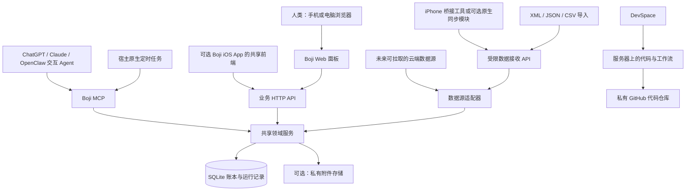
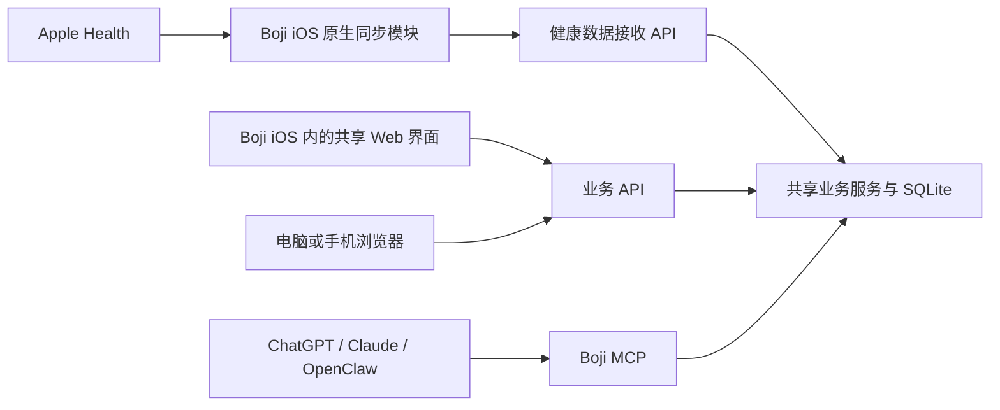

# Boji AI 主动健康系统：MVP 方案设计

> 2026-10-20 实施注：本文保留规划范围。0.1.0 实现状态与接入方式见 [README](../README.md) 和 [API 契约](implementation/API契约.md)；文中的未来工具、调度和 iOS 不表示已交付。

- 版本：v0.2，讨论稿
- 日期：2026-10-19
- 补充日期：2026-10-20，明确 Apple Health 接入是否需要自研 App，以及 iOS 前端的定位
- 适用范围：单用户、自托管、以营养与日常健康数据记录为起点
- 当前交付：方案与工作流文档；尚未实现服务、建立 GitHub 仓库、接入真实健康数据或创建定时任务
- 关联文档：[Agent 工作流与提示词](Agent工作流与提示词.md)、[资料来源与兼容性](资料来源与兼容性.md)

## 1. 本轮已确定的方向

按用户最新意见，采用以下产品边界：

1. **SQLite 是唯一规范数据源，Web 面板是可查看、可修改的管理入口。** MVP 移除飞书多维表格及其同步层，不同时维护两份可编辑账本。
2. **ChatGPT Web、Claude Web、OpenClaw 是交互与推理入口。** 用户把照片交给当前 Agent，模型理解食物并通过 Boji MCP 写入；日常记录不必进入专用 App。
3. **Apple Health 是第一个数据源，不是系统的数据模型。** 所有外部来源经过连接器、标准化、去重和聚合，未来加入其他平台不改饮食核心逻辑。
4. **主动性优先复用 Agent 原生定时任务。** 由宿主负责定时唤醒、模型执行和消息投递；Boji 提供可重复调用的业务工具、检查规则和运行回执。MVP 不开发另一套日历调度器或通知机器人。
5. **DevSpace 是开发与运维入口。** 使用其执行工具在服务器开发、测试、维护代码；日常健康 MCP 使用单独的业务权限与身份，不依赖每餐执行 Shell。
6. **代码与工作流通过 Git 维护，私人数据进入持久数据目录。** 私有 GitHub 仓库也不默认提交真实饮食照片、健康数据库、令牌或原始导出文件。

产品定位：**可被不同 Agent 操作、由人类随时纠正的个人健康账本和可视化面板。** 优先完成可靠记录、修正、汇总和提醒，再讨论更广泛的健康干预。

## 2. 核心见解与需要校正的假设

### 2.1 顶级模型的价值需要用自己的餐食验证

多模态模型可以结合多张照片、用户说明、份量、营养标签、餐前餐后关系和历史修正进行估算，这是本系统希望发挥的能力。**“GPT/Claude 必然比 Cal AI 更准确”目前是产品假设，不是本项目已完成的实验结论。**

第一版不承诺识别出照片中所有营养元素。照片中的油、酱汁、食物重量、糖奶添加和实际剩余量可能不可见；缺乏依据时保留未知或范围，不能用精确小数掩盖不确定性。

真正值得积累的是：用户常吃什么、常用碗盘的份量、已确认的品牌营养标签、经用户修正的常用餐。它们形成可查询的个人食物知识，而不是让模型每天从零猜测。

### 2.2 记录系统负责事实，模型负责解释

- 模型提出食物识别、份量和营养估算，并标明依据与假设。
- 服务端验证结构、管理版本、确定性计算合计和生成报表快照。
- 用户在聊天或 Web 面板修正；二者走同一业务服务和版本检查。
- 长期聊天上下文可以改善交流，但不是数据库，也不是“已成功入库”的证据。

### 2.3 原生定时任务可用，但宿主能力必须实测

官方产品已提供定时任务和工具/连接器能力，但不同产品、模式、套餐、工作区策略及登录状态有不同限制。普通聊天能调用 Boji，不等于同一账户的后台任务也能调用它。当前官方说明还对不同定时任务形态给出了不同的频率边界。[S01–S04]

因此应把“自动任务调用真实 Boji 工具、写入运行回执、完成宿主投递”列为接入验收项，不能用一段提示词代替工具权限、联网能力和调度运行时。

## 3. MVP 范围

| 必须交付 | 具体行为 |
| --- | --- |
| 聊天记录饮食 | 一次发餐食照片或文字，调用 MCP，返回记录 ID、合计、范围、假设和待补充项 |
| 数据可靠性 | 幂等、防重复建议、事务、版本修正、可撤销删除、时间与单位规范 |
| Web 面板 | 今日概览、日记列表、详情与编辑、删除/恢复、趋势、数据源状态 |
| 健康数据接入 | 通用导入/接收接口；Apple Health 文件导入与一条经实测的自动桥接路径 |
| Agent 定时工作流 | 饭点检查、22:00 阶段日报、每 30 分钟数据源巡检；至少一个宿主端到端验收通过 |
| 可复用部署 | 单实例服务、持久卷、认证、健康检查、备份恢复、环境检查与安装文档 |
| Git 交付 | 代码、schema、迁移、工作流、提示词、合成样本和测试；真实数据与密钥隔离 |

第一版不做：多租户 SaaS、医疗诊断、自动开饮食处方、无依据的微量营养补全、双模型每餐强制复核、双向写回 Apple Health、飞书同步、所有健康平台一次性接完、自研 iOS App 作为使用前提。

## 4. 整体架构



采用**模块化单体**：一个后端服务同时提供 `/mcp`、`/api/v1`、`/ingest/v1` 和静态 Web 页面，使用一份 SQLite。初期不拆微服务、不加 Redis、不加独立周期调度服务。

大文件导入可以使用数据库中的作业状态和服务内执行器；这只是有限的导入处理，不承担饭点或日报的周期唤醒。

### 4.1 权限边界

| 入口 | 身份与权限 | 不能获得的能力 |
| --- | --- | --- |
| Web 面板 | 用户登录会话，修改记录、配置和导出 | 未登录访问健康数据 |
| 交互 MCP | 用户授权的健康读写 scope | 任意 Shell、读取服务器任意文件、数据库任意 SQL |
| 定时任务 MCP | 读取、生成报表、申请同步、管理本次回执 | 永久删除、改来源凭证、扩大数据访问范围 |
| 手机桥接 | 单设备、指定来源及指标的 ingest token | 查询全量健康库、修改餐食、调用运维接口 |
| DevSpace | 单独授权的开发运维访问 | 不将其凭证复用为日常健康 MCP 凭证 |

远程 MCP 以 HTTPS + Streamable HTTP 为目标，按官方授权规范完成客户端授权、资源范围验证及 Origin 校验。Web 会话、手机 token 和 MCP token 使用不同用途与权限；不能把长期密钥写入提示词。[S05]

## 5. 饮食工作流

### 5.1 一次记录的完整路径

1. **获取上下文**：当前时间、用户时区、当日餐次、常用食物、已保存份量、当前工作流版本。
2. **识别观察**：照片属于一餐、多角度、餐后剩余、包装标签还是新增一份食物。
3. **估算并解释**：食物、份量、食用比例、营养范围、依据及未知项。
4. **调用 MCP 保存**：服务端验证、确定餐次关联、检查幂等，事务性写入。
5. **读取工具回执**：成功才说“已记录”；返回稳定 `meal_id`、`version`、持久化时间、面板详情地址与当天合计。
6. **等待后续修正**：用户在聊天补充“只吃了一半”或在 Web 编辑，同一餐产生新版本，重新计算汇总。

常规输入无需为每餐增加确认按钮。资料不全可以先保存估算和待补充项；日期或归属餐次有可能记错且影响较大时才做一个短追问。

### 5.2 多角度、餐前餐后与加菜

- 同一盘不同角度是多条 observation，对应一个 meal，不能按照片张数累加。
- 餐前估算保留为 served amount；餐后更新 consumed amount，不新增一顿餐。
- “吃了一半”明确为食用比例；“还剩一半”转换后记录，保存用户原话来源。
- “中途加菜”记录额外食物，再减去可确认剩余；不能直接用两张图片的差异推出全部摄入。
- 昨天的剩鱼今天吃：归入今天实际摄入，昨天如果先按全部吃完记过，要单独修正昨天；不静默改历史。
- 不能从未提供的图片或仅有的附件文件名重新识别食物；历史会话导入应标记图像缺失与来源不完整。

### 5.3 营养指标与证据

| 等级 | 指标 | 默认处理 |
| --- | --- | --- |
| 核心 | 能量 kcal、蛋白质 g、碳水 g、脂肪 g | 每餐尽量估算，无法估算时保留 null 与原因 |
| 常用扩展 | 膳食纤维 g、总糖 g、饱和脂肪 g、钠 mg、饮水 ml | 有标签、可靠数据库或明确配方时填写；否则保留未知或粗估标记 |
| 后续扩展 | 钙、铁、钾、维生素、其他营养素 | 具备来源与覆盖率时启用，不强制从照片补齐 |

每个数值保存 `estimate / low / high / method / source_ref`，不是把整顿饭都标为同一个可信度。`low/high` 是情景估算范围，不是统计置信区间；没有可用范围时留空。

证据类型包括：用户称重、包装标签、官方餐厅营养表、食物数据库匹配、用户自定义、模型视觉估算。标签也可能与实际份量不符，所以仍要保存食用量与来源。

模型判断使用定性质量标签，例如“食物识别较确定，份量不确定”；没有校准实验时不生成看似精确的 0.93 置信概率。微量营养缺数据不得记成零。

营养值明确区分 `per_100g`、`per_serving` 和 `as_consumed`，保存份量与换算依据；服务端只换算一次为本次摄入。已是整份摄入的模型估算不能再次按克数或食用比例相乘，用户修改基准时显示换算后的变化。

营养计算优先级：明确标签或称重 > 用户确认过的常用食物 > 可靠数据库匹配 > 视觉粗估。USDA FoodData Central 可作为标准食物查询来源，但中国混合菜、外卖和餐馆用油必须保留配方差异。[S10]

### 5.4 图像与结构化结果是两条能力

**MVP 的无附件存储模式**：模型看到当前聊天照片，Boji 仅收到结构化结果与用户允许的观察说明。Web 可以展示记录和估算依据，但没有原图时不能展示真实缩略图。

**可选原图模式**：用户明确启用照片留存后，通过宿主已支持的文件传递能力或 Web 上传，把原图保存到私有附件目录。原图、餐食和 observation 关联，缩略图需要登录访问。

不能假定 ChatGPT/Claude 的聊天附件会自动传给第三方 MCP，也不能编造本地文件路径、下载 URL 或附件 ID。DevSpace 本地文档已有原生文件下载能力，但它是否对当前宿主启用、是否支持该文件类型，仍须单独验证；Boji 不把这条能力作为文字入库的前提。

Web 支持手工录入与修正。若从 Web 上传待分析照片，默认进入待分析队列；只有 Agent 确实可读取该图像时才做分析，不偷偷增加需要 API Key 的后端视觉服务。

## 6. SQLite 数据模型与一致性

### 6.1 领域实体

| 实体 | 关键内容 |
| --- | --- |
| `profiles` | 时区、单位、用户明确设置的目标、餐次窗口；MVP 只有一个用户 |
| `meals` | UUID、餐次时间、餐别、状态、当前版本、软删除标记 |
| `meal_items` | 食物、份量、食用比例、营养数值/范围、用户修正 |
| `meal_observations` | 原始文字、附件引用、餐前/餐后/加菜关系、估算方法与工作流版本 |
| `record_revisions` | 修改者、修改来源、修改前后、时间、关联版本 |
| `source_connections` | 来源类型、设备实例、能力、允许指标、凭证引用、连接状态 |
| `health_samples` | 来源样本、指标、起止时间、数值、单位、外部 ID、删除标记 |
| `sync_runs` | 同步请求、游标/水位、样本统计、错误、来源数据时间与接收时间 |
| `daily_reports` | 事实快照、数据版本、截止时间、状态、解释文本与来源 |
| `automation_runs` | 宿主、业务执行槽、租约尝试与隔离版本、执行/交付状态、去重键、错误 |
| `source_incidents` | 来源故障实例、首次/最近观测、恢复时间、故障与恢复通知状态；独立于半小时运行槽 |

幂等键、导入作业和附件元数据可按实现需要使用独立表，不能只放在进程内存。表名为方案级命名，不是现有实现。

### 6.2 写入契约

- 一次餐食写入和审计版本在同一事务提交；失败时不返回成功。
- 使用稳定 UUID，展示名和日期不是主键。
- 修改/删除带 `expected_version`。冲突返回 `VERSION_CONFLICT`，保留双方编辑，不采用最后写入覆盖。
- MCP 与 Web 都走同一服务端校验和计算，不各自在前端或提示词中维护另一套合计。
- 对已知上下界验证 `low <= estimate <= high`；所有单位明确，异常值给出可解释错误。
- 宏量营养与热量的一致性只作合理性提示，不强迫所有食品严格满足 4/4/9 等式。
- 每次影响汇总的修改递增用户数据版本；旧日报标为过期，可按需重算。
- 未记录某餐不等于该餐零摄入；日合计展示“已记录部分”和缺失项。

### 6.3 幂等与相似记录

同一个请求的重复投递，以 `request_id` 与 payload hash 判定：同键同内容返回原结果；同键不同内容返回冲突。可使用宿主原生 message ID 时保留；宿主不提供时，`boji_get_context` 的操作初始化模式先返回可持久查询的操作 ID，后续写入/超时恢复复用；不能每次重试生成新 ID。

相似菜品、相似照片或相近时间只能提示潜在重复，不能自动合并不同日期的同款早餐。跨 Agent 记录同一餐时，优先复用已存在的 `meal_id`。LLM 自报模型名仅保存为报告信息，无法确定则记 unknown，不能伪装为服务端验证结果。

### 6.4 删除与备份

默认删除立即从合计和面板列表中排除，进入可恢复回收站；恢复也产生新版本。永久清除在单独的用户管理操作中说明影响，处理主数据、附件与历史，不作为无人值守任务工具。

软删除与审计保留不是彻底擦除；备份有独立保留期。文档和 UI 必须说明备份何时到期，不承诺删除后所有副本立即消失。

单实例 SQLite 存放在本地持久磁盘，启用外键、迁移和合适的并发控制；不放在网络共享目录供多个服务副本直接写。备份采用 SQLite 一致性备份机制，不在服务运行时仅复制主 `.db` 文件而漏掉 WAL。MVP 提供备份/恢复命令，周期执行可由现有运维任务负责。

### 6.5 数据留存与对模型的可见范围

SQLite、附件和备份放在受限持久目录；数据库文件、原始导出、照片与凭证加入版本控制排除规则，使用加密磁盘/备份并验证恢复。SQLite 的存储访问控制不等于应用内自动加密，具体运行环境的加密方式在部署时确认。

聊天照片及 MCP 返回内容会经过所选宿主供模型处理。context 默认只提供完成本次任务所需的摘要与字段，完整测量序列、身份资料和原始导出不随每次餐食记录全量发送。照片留存、原始导出暂存与备份周期在设置中可见；错误日志记录请求 ID、计数和状态，避免记录凭证和完整健康正文。

## 7. 可扩展健康数据源

### 7.1 三个名词及其关系

| 名词 | 作用 | 例子 |
| --- | --- | --- |
| 桥接工具 / bridge | 在能访问源数据的设备上读取，然后把数据传给服务器 | iPhone 读取 HealthKit 并 HTTPS 推送 |
| 导入适配器 / import adapter | 理解某种文件或供应商格式，转换成 Boji 标准事件 | 把 Apple Health XML、某工具 JSON、体重秤 CSV 转成内部记录 |
| iOS companion | 为 Boji 配套开发的 iPhone App；可以承担 bridge | Swift + HealthKit：授权、增量读取、配对、离线重试 |

它们不是三种互斥的架构：**companion 是桥接工具的一种，桥接工具上传的数据仍需服务器适配器处理。** MVP 可以不自研 iOS App，先使用现成桥接工具或文件导入。未来也可以支持 Android Health Connect 设备桥、厂商授权 API 和体重秤导出文件；这些是扩展方向，当前没有预设它们的授权方式或宣称已接入。

按用户 2026-10-20 的补充要求，**如果开发 Boji iOS App，它同时是人类使用的健康前端**，提供概览、餐食查看与修改、趋势、报告和数据源管理。`companion` 只是配套客户端的称呼，不限制其只能后台搬运数据。当前尚未决定将自研 App 设为首版必选依赖。

### 7.2 统一连接器契约

每个 source connection 声明：

- `modes`：由 `push`、`pull`、`file_import` 组成的能力列表。
- `metrics`：支持哪些指标以及允许读取的范围。
- `supports_deletions`、`supports_incremental`、`supports_history`。
- `sync_status`、最近请求时间、最近接收时间、来源覆盖区间、游标/检查点。
- 时区、单位、采样粒度、聚合方法、原始来源引用。

流程：**连接/授权 → 接收或拉取 → 格式验证 → 单位标准化 → 样本幂等 → 删除/修订应用 → 事务提交及检查点 → 聚合更新 → 运行回执。**

可续传增量游标只能在对应批次持久化成功后推进；失败重跑不得漏数。源标识缺失时使用规范化字段指纹，但标明这是退化去重，不能声称一定识别所有重复和修订。

统一记录需要 `record_kind=sample|aggregate`、指标、来源系统/设备、起止时间、原单位/规范单位、外部 ID、来源版本与接收时间。第三方发送的小时/日统计桶是 aggregate；同一个桶更新时替换相应版本，不追加累加。只有声明完整覆盖的导出才允许在该范围做替换/重建，空结果不构成删除证据。

### 7.3 Apple Health 的接入路径

Apple Health 数据首先在有权限的用户设备上读取；普通 Linux 服务器没有可直接调用的个人 HealthKit 云端 REST 读取接口。用户授权发生在手机桥接 App 内，服务器配对只授权接收其上传，不能代替 HealthKit 权限。[S06–S09]

| 路径 | 用户需要做什么 | 能力与代价 | 推荐顺序 |
| --- | --- | --- | --- |
| Apple Health XML 导入 | 在健康 App 导出，再上传/导入指定文件 | 易于验证历史数据；不是自动同步；导出可能非常大且敏感 | 最先完成，作为历史补录和解析基准 |
| 现成桥接工具 + HTTP 推送 | 安装工具，选择指标，授权，配置 Boji HTTPS 接口 | 最快验证自动路径；格式、后台频率、费用与删除能力取决于工具 | MVP 自动接入首选，选型后实测 |
| 自研 iOS companion | 安装签名 App、设备配对、逐类授权 | 可控制增量、重试和体验；需要 iOS 开发与分发维护 | 第二阶段，默认不阻塞 MVP |

先完成文件导入，再验证一条自动桥接路径；这些能力各有验收标准，不能用手工导入成功宣称自动同步已完成。

自动桥接首选验证候选是 **Health Auto Export**：其官方文档提供自定义 HTTP POST、JSON/CSV 和认证请求头。它是候选桥接端，不是已安装依赖；具体费用、手机/App 版本、聚合格式、原生样本 ID 与删除能力都需在选用时确认。[S09]

**因此，使用 Apple Health 数据不等于必须自己写 iOS App。** 手动导出由系统健康 App 完成；持续自动接入需要设备端获授权的软件参与，可以使用现成 App，也可以开发自己的 App。只有同时要求“Boji 自己直接读取 HealthKit，并自行控制同步与客户端体验”时，本方案才需要承担自研原生模块。

纯 Safari 页面或添加到主屏幕的 PWA 不会因此获得 HealthKit 权限。Apple 的公开集成机制要求应用配置 HealthKit capability 并逐类申请授权；本方案据此将 HealthKit 访问放在原生应用层，Web 只访问已经同步到服务器的数据。此结论是基于公开 API 边界的架构判断，不是对用户手机的实测。[S06、S14]

**自研 companion 的目标行为**：授权允许的指标；用 HealthKit 观察更新并按 anchor 增量取新增/删除；本地持久化待发送批次和检查点；服务端确认后标记提交；断网后补传；前台提供“立即同步”。后台更新取决于 iOS，不能靠定时器保证每 30 分钟运行。锁屏可阻止读取；Apple 文档还明确举例，iOS 的步数后台通知最高为每小时一次。因此自研 App 也不能消除这些限制。[S06–S08]

### 7.4 正确理解“每 30 分钟同步”

拆成两个可观察目标：

1. **设备上传路径**：桥接端在系统允许时推送，提供前台立即同步和离线补传。
2. **Agent 巡检路径**：每 30 分钟检查来源状态；对 pull 来源可请求增量拉取，对 push 来源只能检查/提示或记录待同步请求。

服务器和 Agent 不能凭一条 MCP 调用强制唤醒 iPhone。对 push 来源，`sync_requested` 仅表示请求已保存；只有收到新批次并完成入库，才能返回“同步成功，接收 N 条样本”。

把“30 分钟”定义为期望新鲜度和检查周期，UI 同时显示 `last_received_at`、`source_coverage_end` 和 stale 状态；即便刚接收到一个很旧的文件，也不能显示数据已经实时更新。

### 7.5 首批健康指标与多来源聚合

首批：步数、活动能量、静息/基础能量（来源支持时）、运动、睡眠、体重。饮水可以来自用户手工记录或授权来源，需避免双计。其他平台后续按同一连接器契约加入，不承诺在 MVP 已实现。

需要区分**同源去重**和**跨源融合**：

- 同源：`source_connection_id + external_sample_id + revision` 标识新增/修订；支持删除的来源传递 tombstone。
- 跨源：Apple Watch、iPhone、未来手环的数据可能描述同一活动，不能直接把步数和能量相加。
- 每个指标定义明确的来源优先级、重叠窗口与聚合策略。日汇总与细粒度样本不可再次相加。
- 累计量、瞬时测量、区间睡眠和训练事件采用不同聚合方法；缺失值不填零。
- 不支持删除通知的桥接工具必须展示限制，并允许按来源/日期重建；不假装导入是完整镜像。
- 睡眠跨午夜，显示按既定“醒来日”或睡眠窗口分组；保留原始起止时间，避免机械按日切断后重复计算。

能量展示中分列摄入、活动能量、静息能量。来源不能证明“总消耗 = 哪些不重叠部分”时，不生成确定性的热量缺口，也不把摄入减去步数估算当成实测能量平衡。

### 7.6 外部测量的人类修订

餐食估算和手工录入可以直接修订。外部健康测量保留原始来源值；用户通过独立的本地 override、注释或 ignore 标记修改展示/聚合结果，来源重传不能覆盖该决定。

在面板删除一条外部测量时，默认含义为“在 Boji 中忽略”，不等于已删除 Apple Health 的原始样本。保留匹配标识与本地忽略状态，防止下次同步复活。恢复清除本地忽略，继续使用当前来源版本。数据源端确实删除时应用其 tombstone，不把长期离线后没有收到删除误当作镜像已一致。

## 8. Web 面板与人类调整

### 8.1 页面与移动体验

| 页面 | MVP 内容 |
| --- | --- |
| 今日 | 已记录摄入、核心营养、餐次时间线、待补充项、健康来源新鲜度；目标未设置时不画假目标进度 |
| 饮食日记 | 日期/餐别筛选、搜索、范围和证据标记；原图可用时显示缩略图 |
| 餐食详情 | 单项营养、份量、实际食用比例、观察/图片、计算依据、版本历史 |
| 编辑面板 | 修改日期餐别、食物、份量、比例和营养；实时预览新旧差异与总量 |
| 趋势 | 近 7/30 天摄入、蛋白质、体重和活动；区分缺测与零，显示数据覆盖情况 |
| 数据源 | 指标授权范围、最近接收/覆盖时间、同步记录、错误、立即同步能力或前台操作提示 |
| 设置与回收站 | 时区、目标、数据留存、导出、删除恢复、绑定的自动任务状态 |

优先采用手机友好的卡片和时间线，桌面可用表格。图表选取克制：已知记录画实线，缺测断开，估算范围用区间，不使用没有定义的综合“健康分”。

### 8.2 编辑契约

- 打开编辑时读取当前 `version`，提交携带该版本。
- 改份量后可选择按原配方比例重算；直接修改某营养数值会标记为用户覆盖，不被下一次模型计算静默冲掉。
- 提交前显示新旧能量/营养变化与影响日期；保存成功后显示新版本与“撤销本次修改”。
- 撤销是基于最新版本的反向修订；有后续变更时展示冲突，不回滚他人后续修改。
- 删除后提供撤销入口，回收站可恢复；多选批量删除先显示范围和影响。
- 图像缺失、同步过期、估算不全是可见状态，不能用 0 或无来源缩略图填空。

可借鉴 wger 的营养日记与份量编辑、OpenNutriTracker 的今日营养概览，以及 Mealie 的机器导入后人工校正流程。它们分别覆盖不同产品用途；前端参考和许可证在资料文档中说明。[S11–S13]参考的是信息层次、日记交互和图表，而不是在没有许可证分析时复制整套前端。第一版不从复杂健身平台 fork 整套业务。页面优先级是“今日 + 可编辑记录 + 待核对 + 数据管理”，简单 7 日趋势放在概览，独立高级趋势页和批量编辑可延后。

### 8.3 可选 Boji iOS App：数据桥接与日常前端

**产品方向已明确，开发顺序仍是建议：若做 App，应让用户在同一个 App 内完成健康数据授权、查看和人工修订。** 推荐先交付手机友好的 Web，再用轻量原生应用承载同一套页面；Apple Health 的授权和同步由独立 Swift 模块处理。

| 部分 | 目标能力 | 建议实现 |
| --- | --- | --- |
| 今日、饮食、趋势、报告 | 核心营养概览、记录详情、修改份量、删除/恢复、查看日报 | 复用响应式 React Web，通过业务 HTTP API 读写 |
| 设备与健康连接 | 配置自托管服务器、配对、请求 HealthKit 权限、显示同步状态、立即同步 | Swift / SwiftUI 原生界面 |
| 数据同步 | 观察变化、增量读取、删除事件、待发送队列、重试和检查点 | 独立原生 HealthKit 模块；不依赖网页保持打开 |
| 照片附件（可选后续） | 用户拍照或选图并附到指定记录 | 明确授权后上传；与自动识别能力分别验收 |

推荐的初版技术路径是 **SwiftUI 应用结构 + HealthKit 同步模块 + WKWebView 复用 Web 页面**。Apple 提供 WKWebView 在原生 UI 中呈现交互式网页；这是技术可行性的依据，不代表本项目已验证登录、键盘、导航和后台行为。[S14] 初版可加载配对服务器上的 HTTPS 页面，健康权限和同步状态使用原生页面，服务不可达时仍能查看设备队列和重试状态。是否打包前端资源以及更完整的离线浏览，在后续根据真实需求决定。

这种设计让电脑浏览器和手机 App 共用表单、图表与业务 API。纯原生 SwiftUI 前端也可采用，但需要额外维护一套页面；当前没有足够收益要求重写所有 UI。后台可靠性来自原生同步模块及系统调度条件，不能通过把 Web 页面放进 App 自动获得。



**权限分开管理**：设备同步凭证存于原生安全存储，只能上传该设备获授权的来源；前端使用独立用户会话操作餐食。不要把 ingest token 赋予修改餐食的权限，也不要把长期原生凭证注入网页。前端直接向 Boji API 读取已入库的摘要，原始 HealthKit 批次由原生模块直接上传。

原生与网页之间如需通信，只开放必要且有参数校验的能力，限制到已配对的 HTTPS origin 和主框架；初版可以直接使用原生“同步”页，避免建立通用 HealthKit JavaScript 接口。第三方链接在系统浏览器打开，不继承原生桥接能力。服务器地址变更需要重新配对，不能由网页静默改写上传目的地。

App 的手工操作同样使用记录版本、事务回执和删除恢复机制；服务器不可达时不显示“已保存”。原生待上传健康数据的离线队列，与离线编辑餐食是两个不同能力，后者不在初版自动承诺。

聊天仍是首版模型分析入口：在 ChatGPT/Claude 发餐食照片 → 模型通过 MCP 保存 → App 和 Web 展示结果。**App 能拍照或上传附件，并不自动拥有 ChatGPT/Claude 的推理调用能力。** 如果以后要求在 Boji 内拍照后自动分析，需要另接模型 API 或用户控制的 Agent 执行端，并明确调用成本、授权和结果回执。宿主定时提醒沿用既有设计；App 查看已保存的报告即可，不额外引入另一套定时调度器。

自研 App 的验收增加：真机逐类授权与撤销、锁屏/断网后的状态与补传、前台立即同步、App 修改后 Web/MCP 回读、登录过期、键盘与返回导航、外部页面无法调用原生能力。安装、签名和对外分发另有流程，服务器一键启动不等于 iOS App 自动安装和健康授权。该方向尚未实施。

## 9. MCP 与业务 API 草案

以下是**待实现的契约**，不是当前可调用的工具。工具使用统一 `boji_` 前缀，返回结构化结果和简短文本摘要；宿主不支持 MCP resources/prompts 时也能通过 `boji_get_context` 获取工作流。

| 工具 | 用途 | 权限 |
| --- | --- | --- |
| `boji_get_context` | 当前时间、时区、用户设置、当日记录、工作流版本与注意事项 | 读 |
| `boji_record_meal` | 保存一顿餐食和观察，返回持久化回执 | 写 |
| `boji_get_meal` | 读取单餐及版本、依据和关联观察 | 读 |
| `boji_list_meals` | 有限日期范围查询、分页 | 读 |
| `boji_update_meal` | 按 `expected_version` 修正食物、份量、营养或日期 | 写 |
| `boji_delete_meal` | 按版本软删除 | 写/破坏性提示 |
| `boji_restore_meal` | 按版本恢复 | 写 |
| `boji_get_summary` | 读取日/周事实合计、范围、缺失与来源新鲜度 | 读 |
| `boji_get_source_status` | 读取来源能力、最近同步与错误 | 读 |
| `boji_request_sync` | 对 pull 来源执行/排队，对 push 来源登记请求或给出限制 | 受限写 |
| `boji_run_checkin` | 申请饭点、日报或 `source_check` 执行槽，计算事实、故障实例与是否需提醒 | 自动任务写 |
| `boji_complete_checkin` | 保存发送准备、已交宿主、成功凭据、未知或失败状态 | 自动任务写 |

长导入通过 UI 上传或受限 ingest API，MCP 查询作业状态；不把完整 XML 或成千上万条样本塞入模型上下文。所有查询默认有时间范围与数量限制。

### 9.1 稳定回执示意

```json
{
  "status": "persisted",
  "operation_id": "operation-example",
  "meal_id": "meal-example",
  "version": 2,
  "data_revision": 18,
  "persisted_at": "2026-10-19T12:35:00+08:00",
  "timezone": "Asia/Shanghai",
  "totals": {
    "energy_kcal": {"estimate": 780, "low": 650, "high": 950},
    "protein_g": {"estimate": 32, "low": 25, "high": 40}
  },
  "quality": {"portion": "uncertain", "requires_followup": true},
  "warnings": ["烹调用油未知", "糖和钠未形成完整估计"]
}
```

示例数值与 ID 均为合成数据。`status=persisted` 由后端事务成功后生成；模型不能自行模拟成功回执。Web 和 MCP 返回同一个规范记录版本。

## 10. Agent 原生定时任务

### 10.1 谁负责什么

- **宿主**：保存日程，按时唤醒，提供工具权限/凭证，执行模型或脚本，向用户投递。
- **Boji**：保存偏好、计算是否已记录、生成事实日报、保护幂等和并发、留下调用与交付证据。
- **提示词/skill**：规定调用顺序、时间口径、通知语言、缺数据和失败处理；不赋予宿主本来没有的能力。

MVP 不提供自建周期 Scheduler。若某宿主无法执行，先换到已验收的宿主；需要自建调度器时另行作为后续范围，而不是悄悄加入兜底服务。

### 10.2 任务安排示意

以下饭点仅为可修改建议，尚未创建任务：时区默认 `Asia/Shanghai`，早餐 08:30、午餐 12:00、晚餐 18:30；日报 22:00；健康来源巡检每 30 分钟。

| 任务 | 业务行为 | 通知原则 |
| --- | --- | --- |
| 饭点 | 检查当前餐次窗口；已有记录/主动跳过则静默，否则提醒拍照 | 每个饭点一个业务槽；不连发催促 |
| 来源巡检 | 检查新鲜度；pull 来源有条件同步，push 来源只检查或提示 | 正常且无变化静默，持续故障去重提醒 |
| 日报 | 以服务端事实快照汇总至 22:00，说明缺失及同步滞后 | 一份阶段日报；有晚到数据时允许修订 |

每 30 分钟执行模型任务意味着每天 48 次运行；纯状态检查可优先使用宿主的脚本/命令任务直接调用同一业务能力，不要求每次调用顶级模型。[S04]

### 10.3 22:00 是阶段快照，不是假装一天已经结束

- 每日统计使用用户时区的当地日边界。22:00 报告的事件窗口为当地当天 `[00:00, 22:00)`；`event_cutoff_at`、`received_at`、`generated_at` 和 `data_revision` 分别记录，不能混成一个时间。
- 原始报告保留当时的不可变快照。迟到数据如果实际发生在 22:00 前，可生成相同事件窗口的校正版，并注明更新/接收时间；旧报告仍可回看。
- 例：22:20 补记的 21:30 晚餐可进入 22:00 校正版；实际 22:10 吃的夜宵只能进入全天/较晚截止视图。事件在窗口边界的区间样本按指标规则裁剪或注明跨窗，不直接整桶加入。
- 最低要求是显示“截至22:00发生、且生成时系统已知的记录”；若扩展到22:10之后，必须更改截止时间与标题，不能沿用22:00日报名称。可选次日上午生成前一日全天校正版。
- 睡眠按单独窗口展示。缺少餐次/活动数据时提示不完整，不补零，不虚构能量缺口。
- 营养合计和范围由服务器计算，Agent 只根据该快照组织说明。

### 10.4 防止多个 Agent 重复提醒

为每个任务类型和时段设置一个主宿主。多个客户端可以读写饮食，但同一饭点/日报默认只由一个宿主负责。

服务端业务键使用 `profile_id + task_kind + local_date + slot_id`，与宿主名字无关；这样切换 ChatGPT/OpenClaw 后仍能识别同一个执行槽。`task_kind` 至少包含 `meal_reminder`、`daily_report`、`source_check`。slot 由服务器按绑定规则生成，半小时巡检 slot 还包含对应的 UTC 时段/偏移，避免夏令时重复小时冲突。租约、状态和去重键落到 SQLite。

领取、重领和状态推进在 SQLite 中原子执行。每次尝试有新的 `attempt_id`、递增 `fencing_epoch`、`lease_token` 与 `expires_at`。只有当前、未过期的持有者能进入 `prepared`；服务端拒绝旧 epoch/令牌，Agent 被拒后必须停止，不得继续生成或发送提醒。进入 `prepared` 后不因普通租约过期重新派发。由此覆盖 A 暂停、租约过期、B 重领、A 恢复的场景；不是只靠约定唯一任务名。

交付状态必须区分：`leased`、`prepared`、`handed_to_host`、`delivery_confirmed`、`delivery_unknown`、`failed`、`silent`。

- 工具生成内容成功不等于消息已送达。
- 在可能发送前持久化 prepared；确有宿主 delivery ID/成功回执才标 confirmed。
- 若宿主只会在任务最后自动发送回复，通常只能记录 handed_to_host，最终投递由宿主记录证明。
- 发送准备后崩溃或状态不明，不自动重复发送；记录 unknown 并供检查。
- 只有尚未开始发送的过期租约可以安全重领；旧持有者必须通过发送准备的隔离校验后才能输出通知。MVP 不承诺网络意义上的 exactly-once 投递。

**来源告警另按故障生命周期去重**：`source_check` 每半小时都有运行槽，但告警键基于 `profile_id + source_connection_id + incident_id + phase`，不基于检查时间。一个故障实例从首次观测持续到确认恢复，`phase` 区分故障通知与恢复通知。未达到用户设置的持续时间阈值时不发送；达到后只准备一次。连续多个半小时仍失联时更新最后观测，不生成新实例；恢复关闭实例，之后再次失联才创建新实例。告警和恢复都使用同一 prepared/交付未知状态契约，未知投递不自动重发。来源巡检发现故障、申请同步与发消息是独立可观察结果。

### 10.5 能力矩阵与实际接入验收

| 宿主 | 已有官方依据 | Boji 接入仍需证明 |
| --- | --- | --- |
| ChatGPT Web | 原生 Tasks/Work 调度、通知；可连接自定义 MCP | 当前账户/模式的后台任务能否调用指定 Boji 工具、允许的频率、写操作是否会等待审批 |
| Claude | 远程自定义连接器；定时任务可使用已连接的连接器 | 实际使用的是 Web/平台能力还是 Cowork 本地模式、Boji 工具权限、离线运行条件 |
| OpenClaw | Gateway 原生 automation，持久日程、agent/script/command payload、可控交付 | 实际已安装版本的工具 allowlist、MCP 连接、脚本能力、Gateway 常驻和通知渠道 |
| 其他 Agent | 不预设兼容 | 同一套能力探测与测试；未通过前不写“支持” |

ChatGPT 与 Claude 的产品文档更新较快，当前可用性以来源快照及真实账户验收为准。常规聊天的 MCP 接入、后台工具调用、最终通知是三个独立测试。[S01–S04]

接入验收步骤：连通只读工具 → 一次合成餐食写入/回读 → 单次后台任务查询与业务回执 → 实际宿主通知 → 验证 30 分钟间隔可用性/宿主在线条件 → 才创建长期任务。任何一步失败保留明确状态，不声称全链路已通过。

## 11. 工程与仓库组织

建议 TypeScript 后端 + React/TypeScript Web，统一 schema 和领域类型；MCP SDK 按实施当时的官方稳定版本锁定。SQLite 驱动、Web 框架、图表与组件库在实现 Spike 后选择并固定，不在方案里虚构当前最新版本。

```text
boji-ai-health/
├── README.md
├── apps/
│   ├── server/                 # MCP、业务 API、ingest、静态资源托管
│   └── web/                    # 人类查看、修改、删除与恢复
├── packages/
│   ├── domain/                 # 合计、版本、业务规则
│   ├── contracts/              # schema、MCP 输入输出、数据源事件
│   ├── persistence/            # 第一版只实现 SQLite
│   └── connectors/             # Apple XML、选定的推送格式、未来来源
├── workflows/                  # meal-log、correction、checkin、daily-report
├── prompts/                    # 主提示词和各宿主任务模板
├── migrations/
├── examples/synthetic/          # 可公开的合成数据
├── tests/
├── deploy/
└── docs/
```

这是一份目标结构，不代表目录中的服务已存在。当前文档不创建上述应用骨架。先开发一个 SQLite 实现；未来真有另一后端需求再抽象，不提前建设多后端数据库框架。

工作流版本、schema 版本和 Git 发布版本关联；Boji 通过 context/resource 提供当前版本。Agent 定时提示词保持简短，运行时获取受控版本规则；不能读取任意第三方链接并据此提升权限。

服务器常驻由 systemd 或容器重启策略负责；开发机若是 Mac 可使用其服务管理方式。这个进程保活与业务周期调度是不同概念。

## 12. 一键搭建的真实边界

目标是**一条启动命令 + 引导式配置**，而不是声称无需授权即可接上手机和所有 Agent。

部署向导依次完成：运行环境检查、持久目录、SQLite 迁移、管理员登录、HTTPS 公开入口、MCP 客户端授权、可选桥接设备配对、任务模板导入及试跑。

- 私有仓库先用于个人开发，后续可开源代码模板；开源前检查 Git 历史和示例数据。
- 个人配置保留本机/服务器安全目录，不要求每位使用者 fork 一个包含真实数据的仓库。
- 提供合成 demo，让没有 Apple Health 的用户也能体验饮食和面板。
- 不在此阶段捏造尚不存在的 npm 包或 `curl | bash` 安装地址。
- “服务启动成功”“MCP 已授权”“数据源已同步”“任务已送达”分别输出结果。

## 13. 分阶段交付与验收

| 阶段 | 产物 | 验收证据 |
| --- | --- | --- |
| P0：能力 Spike | 最小 Boji MCP、合成数据、一个只读页 | 交互与后台任务分别调用真实工具；记录准确的宿主能力矩阵 |
| P1：饮食闭环 | SQLite、餐食 CRUD、修正、今日合计、Web 编辑与回收站 | 聊天保存→Web 改份量→MCP 回读新版本；删除排除合计；恢复正确 |
| P2：数据源闭环 | 标准事件、Apple XML、选定桥接 HTTP 接收 | 历史样本与推送样本去重；重传/断网补传/过期状态；来源限制明确 |
| P3：主动工作流 | 饭点、22:00 报告、来源巡检、运行记录 | 已记录静默、并发只领一个槽、日报有截止时间、交付状态不误报 |
| P4：分发完善 | 安装引导、备份恢复、文档、脱敏与发布包 | 新环境可用合成数据跑通；备份恢复结果一致；数据不进 Git |
| P5：可选增强 | 兼具健康前端的自研 iOS App、更多来源、常用餐和更深趋势 | 原生同步 + 共享界面分别验收；不阻塞前述 MVP |

前端从 P1 就交付可操作版本，不能等所有来源接完才让用户纠正数据。Apple 自动桥接、宿主后台调用与原图传输均属于需要实测的外部边界；预计工作量应在 P0 后再给，不预先承诺精确天数。

若后续选择自研作为个人主接入路径，可以在 P1 后将轻量 iOS App 提前到 P2，与现成桥接二选一作为首条自动路径；无需先完成两套桥接。可复用项目仍保留 Web 和文件导入，方便没有 Apple 设备的用户使用。用户当前表达的是“如做 App，希望它兼作前端”，不据此自动扩大为立即实现或发布 App。

## 14. 验证策略

### 14.1 功能和数据

- 幂等同键同内容重放一次；同键不同内容拒绝。
- 两张同盘照片不增加第二份；餐前/餐后/加菜关联正确。
- UI 与 MCP 并发改同餐时版本冲突可解释，人工覆盖保留。
- 每个修改/删除影响正确日期，回收站恢复后合计一致。
- 缺餐、缺指标、估算范围、跨午夜/时区/夏令时有测试。
- 来源重传、分页中断、检查点推进、删除事件、重叠样本不导致漏数或双计。
- 22:00 快照遇到晚到数据能识别过期，修订不静默重发通知。
- 双宿主竞争、发送准备后崩溃、租约过期和 delivery_unknown 有故障测试；特别覆盖 A 暂停→B 重领→A 恢复时旧租约被拒绝。
- 同一来源连续 3 次巡检失联，超过阈值只生成一次故障通知；恢复只通知一次，再次故障生成新实例。unknown 投递不重复发送。
- 验证 22:20 补录的 21:30 事件进入 22:00 校正版，而 22:10 事件只进入更晚截止的视图；原快照不被覆盖。

### 14.2 用户路径和权限

真实宿主照片→模型估算→MCP 写入→Web 读取→手工修正→宿主回读；另跑一次真实后台任务与通知。禁止用纯 API mock 代替宿主验收。

Web 手机宽度、键盘输入、保存错误、撤销、冲突、图表缺测、来源过期可视检查；记录控制台与服务器异常。越权、无登录附件访问、过期 token、上传限制及提示注入作为边界验证。

SQLite 备份必须恢复到干净环境，核对记录数、版本与合计。开发、预发布与个人正式数据分开，不在真实库做合成破坏测试。

### 14.3 模型估算质量

先用一组有称重/标签依据的餐食建立样本，再加入常见中餐和混合菜。对比模型输出与可靠参考，记录绝对误差、蛋白质误差、估算范围覆盖、份量识别和用户修正率。

模型识别准确率与份量/营养误差分别统计。复用同一来源区间不能伪装为独立真值；缺少实际食用量的图片不能算已建立金标准。小样本仅作产品校准，不宣称临床验证或普遍优于其他 App。

## 15. 关键取舍与待讨论项

| 决策 | 本方案推荐 | 代价与理由 |
| --- | --- | --- |
| 存储/展示 | SQLite + 自建 Web | 需要开发 UI，换来一个事实源与完整编辑链路 |
| Agent/服务分工 | 宿主推理与调度，服务确定性记账 | 减少 API 和调度重复建设；须面对宿主可用性与审批限制 |
| Apple 首版 | 文件导入 + 现成桥接适配 | 依赖桥接工具能力；自研 App 延后 |
| 自研 iOS 的定位 | 如开发，则包含健康同步和日常前端；优先复用 Web | 增加原生同步、签名与真机测试；是否提前到 P2 待决定 |
| 原图 | 默认结构化入库，原图留存可配置 | 不依赖宿主文件传递；默认面板不能回看原图 |
| 自动任务所有者 | 每个时段一个主宿主 | 减少重复；不做自动跨宿主故障切换 |
| 22:00 日报 | 阶段快照，支持修订 | 必须清楚标记不完整和数据滞后 |
| 健康建议 | 记录、趋势、证据与用户目标 | 不替代诊断，涉及疾病/特殊饮食目标另行设计授权与专业边界 |

下一轮讨论主要影响实施顺序的是：首个定时任务宿主、是否要求原图留存、Apple 桥接工具的可接受依赖与费用、服务器部署位置。其余采用上面的默认值即可开始 P0，不需要先选完所有未来平台。

## 16. 本轮边界与参考资料

本轮只交付文档。当前文档位于本地工作区，尚未同步到远程开发机或 GitHub。未创建自动任务、未申请 HealthKit/平台权限、未安装桥接 App、未部署网站或 MCP，也没有验证真实账户的后台工具调用。

外部能力来源、核实日期、前端参考项目及尚未验证项见 [资料来源与兼容性](资料来源与兼容性.md)。本文中的架构、工具名、表结构和验收要求均是设计建议；官方产品事实与本项目实现状态分开陈述。
